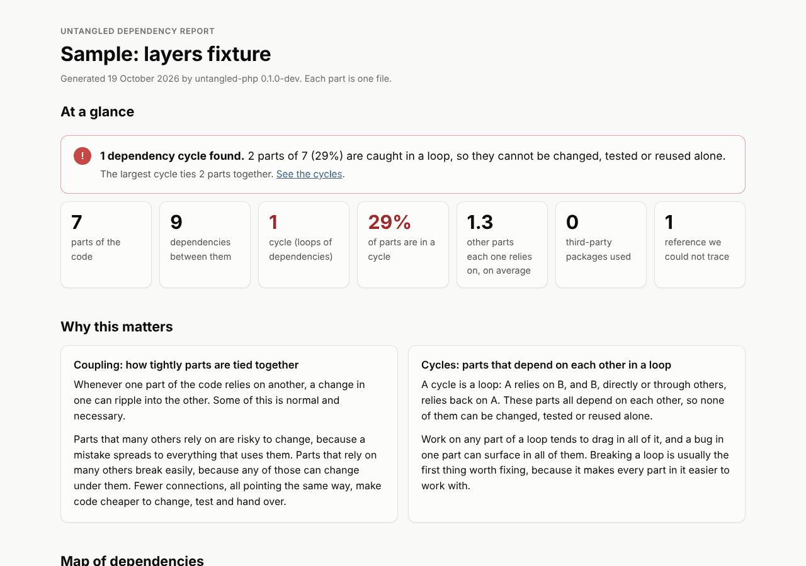
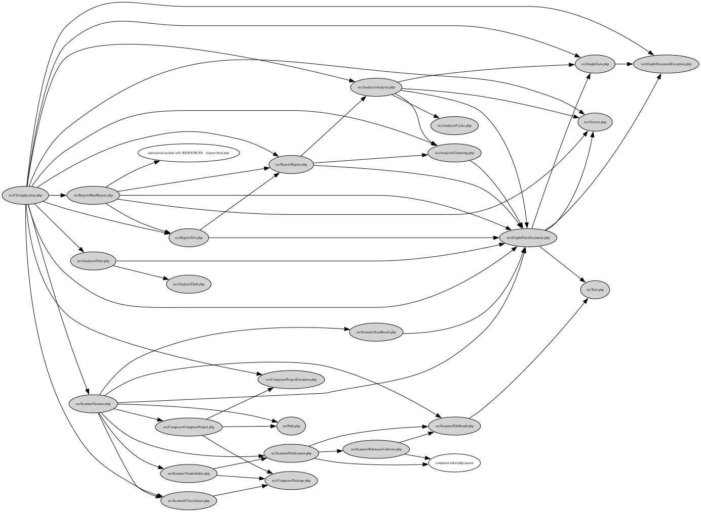
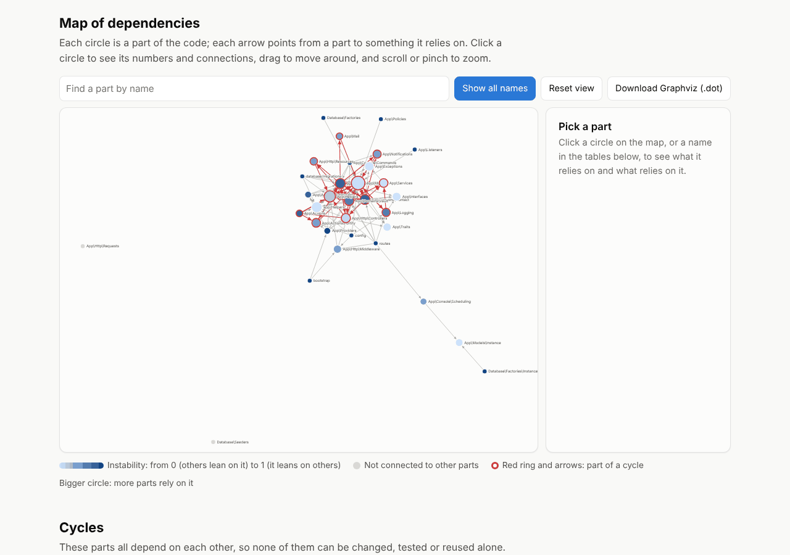
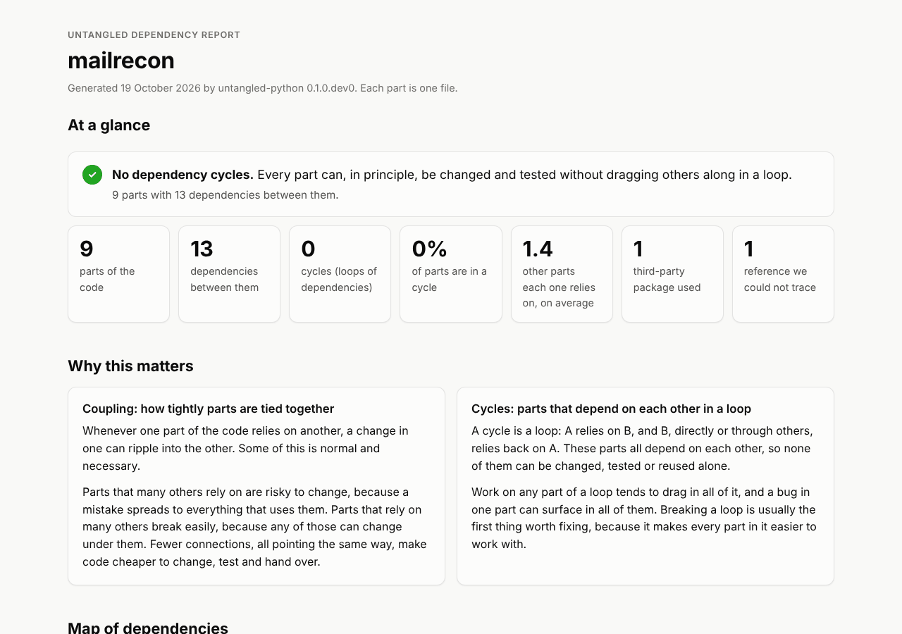
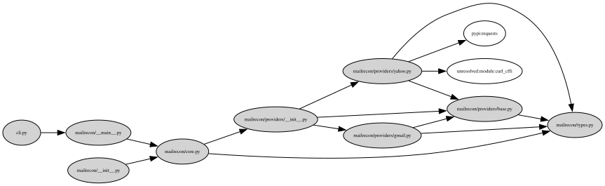
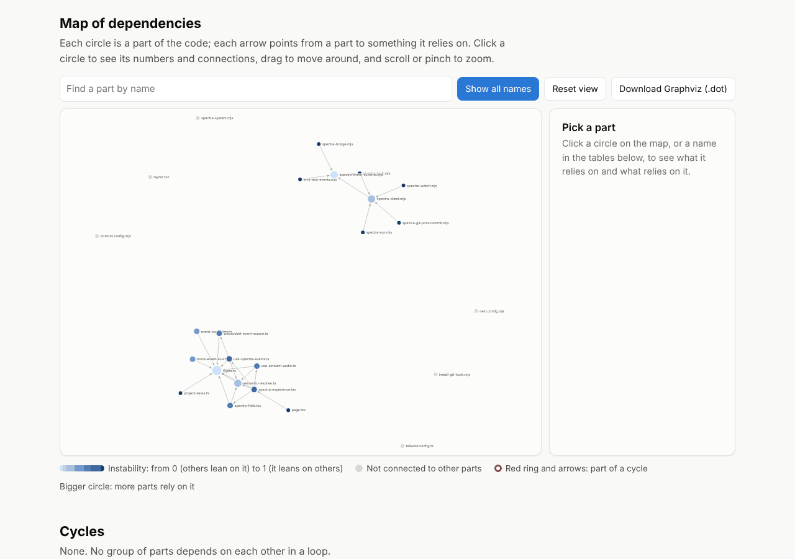
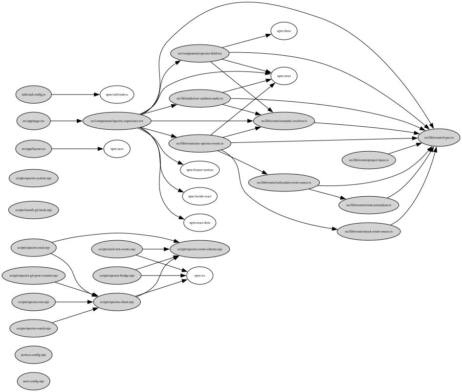

# Examples

What Untangled's output looks like on real code, one project per language.
Every file here is in [`docs/examples/`](docs/examples/): the HTML reports
(download one and open it in a browser, it needs no network), the classic
graphs as SVG and as Graphviz `.dot`, and screenshots of the reports.

All of them are regenerated with [`scripts/make-examples.sh`](scripts/make-examples.sh),
which clones the outside projects at pinned commits.

## Start here: the layers fixture

A tiny project from the [conformance cases](conformance/cases/layers/README.md)
with a known shape: three namespaces, seven files, one small cycle
(`Router ↔ UserController`) and one class that does not exist.

[](docs/examples/fixture-layers-report.html)

The top of every report says in plain words whether there are cycles, then
gives the numbers: parts, dependencies between them, cycles, how many parts
each one relies on, third-party packages, and references that could not be
traced. The rest of the page explains why each of these matters.

```sh
php/bin/untangled report conformance/cases/layers/php/project --output=report.html
```

## A clean project: Untangled itself (PHP)

25 files, 54 dependencies, no cycles, one third-party package
(`nikic/php-parser`).

[](docs/examples/php-untangled-report.html)

The same project as a classic graph, in the black and white look of
snakefood's `sfood-graph`: project files in grey, packages in white.

[](docs/examples/php-untangled-classic.svg)

```sh
php/bin/untangled report php --output=report.html
php/bin/untangled report php --format=dot --style=classic | dot -Tsvg > graph.svg
```

## A real app with a cycle: Monica (PHP, Laravel)

[Monica](https://github.com/monicahq/monica) is an open-source personal CRM.
Grouped by the first three levels of the namespace, it has 33 parts, and 13
of them form one loop: `App\Actions → App\Actions\Fortify →
App\Domains\Settings → App\Http\Controllers → App\Actions`, with models,
services, mail and notifications pulled in along the way. Cycles are drawn in
red on the map.

[](docs/examples/php-monica-report.html)

Laravel code lives partly outside Composer's autoload rules (routes, config,
migrations), and Laravel registers global class aliases such as `Route` and
`DB` at runtime. `--source` adds those folders and `--aliases=laravel`
resolves the aliases, so the graph matches what the app really does.

```sh
php/bin/untangled report /path/to/monica --cluster=namespace:3 \
  --source=routes --source=config --source=database/migrations --source=bootstrap \
  --aliases=laravel --output=report.html
```

The classic graph, one level coarser (`namespace:2`):
[php-monica-classic.svg](docs/examples/php-monica-classic.svg).

## Python: mailrecon

[mailrecon](https://github.com/krazybean/mailrecon) is a small Python
project: 9 files, 13 dependencies, no cycles.

[](docs/examples/python-mailrecon-report.html)

[](docs/examples/python-mailrecon-classic.svg)

```sh
untangled report /path/to/mailrecon --output=report.html
untangled report /path/to/mailrecon --format=dot --style=classic | dot -Tsvg > graph.svg
```

## JavaScript / TypeScript: spectra

[spectra](https://github.com/krazybean/spectra) is a Next.js app with a set
of Node scripts: 25 files, 28 dependencies, 8 npm packages, no cycles. The
map shows two groups that never import each other (the app and the
`scripts/` tools), and one file, `src/lib/events/types.ts`, that almost
everything in the app leans on. Imports through the tsconfig `@/` alias are
resolved.

[](docs/examples/js-spectra-report.html)

[](docs/examples/js-spectra-classic.svg)

This report was made from the JS/TS scanner's output by the Python library,
because the JS/TS library does not write reports yet. It will be regenerated
with the JS/TS library once it does.
