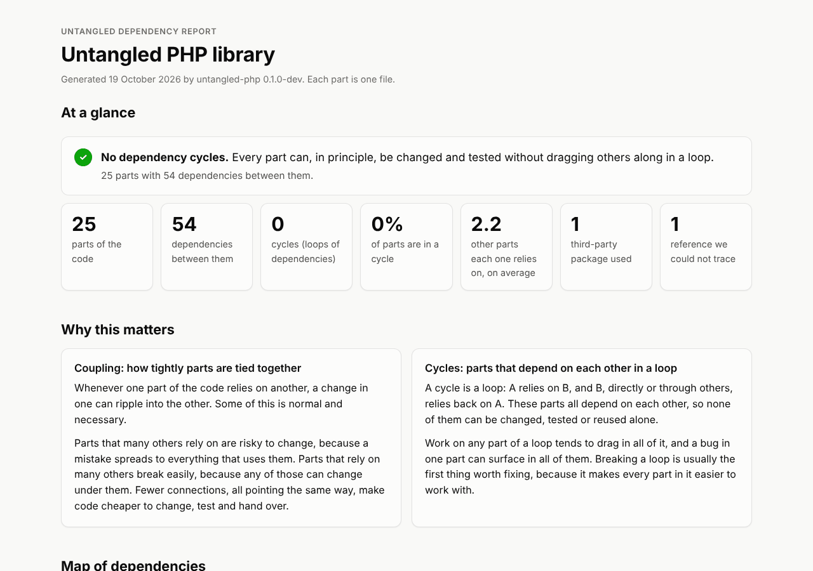

# Untangled

**Dependency health your whole team can understand.** Cycles, coupling and
trends over time, in the same terms for PHP, JavaScript/TypeScript and Python.

Untangled scans a codebase, builds the graph of which files depend on which,
and turns it into numbers and a readable report: where the cycles are, which
parts everything leans on, and which parts lean on everything. The reports are
written for engineers *and* for the people they report to, with plain-language
explanations of why coupling matters.

[](EXAMPLES.md)

More reports and graphs, on real PHP, Python and JavaScript projects, are in
[EXAMPLES.md](EXAMPLES.md).

> **Status:** PHP and Python 1.0.0 are out, on
> [Packagist](https://packagist.org/packages/krazybean/untangled) and
> [PyPI](https://pypi.org/project/untangled/). JavaScript/TypeScript scanning works; its analysis
> and report are in progress. See [Roadmap](#roadmap).

## Credit: snakefood

Untangled is a re-imagining of **[snakefood](https://github.com/blais/snakefood)**
by **Martin Blais**. The idea and the design are his: scan source files into
a plain list of `(from, to)` dependency pairs, then filter, cluster and render
that list with small, composable tools. Untangled keeps that pipeline,

```
scan ──▶ pairs ──▶ filter / cluster ──▶ analyze ──▶ render
```

and its pairs format is a direct descendant of snakefood's (Untangled can
still write snakefood's format with `--format=snakefood`). snakefood supports
Python 2 only and has not been maintained since 2017; Untangled exists to carry
the idea to PHP first, then to JavaScript/TypeScript and Python 3, with metrics,
reports for non-engineers, and history over time added on top.

Thank you, Martin.

## Why Untangled

- **PHP first.** PHP has rule enforcement ([deptrac](https://github.com/deptrac/deptrac))
  but no maintained tool that visualizes dependencies and measures coupling.
- **Reports for the whole team.** One self-contained HTML report with an
  interactive graph and short explanations a manager can follow.
- **Change over time** (planned for v2). Run against git history: "coupling in
  `Billing/` doubled this year", "this pull request added a cycle".
- **Comparable across languages.** Metric definitions live in one shared
  [specification](spec/README.md), and every language's library is tested
  against the same [conformance cases](conformance/README.md).

## Packages

One repository, one native library per language, with the same command name
and options everywhere. There are no cross-language edges: each language is
analyzed on its own.

| Language | Folder | Package | License | Status |
| --- | --- | --- | --- | --- |
| PHP | [`php/`](php/README.md) | `krazybean/untangled` (Packagist) | MIT | 1.0.0 |
| Python | [`python/`](python/README.md) | `untangled` (PyPI) | GPL-2.0-only | 1.0.0 |
| JavaScript / TypeScript | [`typescript/`](typescript/README.md) | `@krazybean/untangled` (npm) | MIT | scan works; analyze and report in progress |

## Quick start

The command and its options are the same in every language. `utg` is a short
alias for `untangled`.

**PHP** 8.2+, for a project with a `composer.json` (classes are resolved
through its Composer autoload rules):

```sh
composer require --dev krazybean/untangled
vendor/bin/untangled report --cluster=namespace:2 --output=report.html
```

**Python** 3.11+:

```sh
pip install untangled
untangled report /path/to/your/project --output=report.html
```

Then open `report.html` in any browser. `analyze` writes the same numbers as
JSON, for CI, and `report --format=dot --style=classic` draws the classic
snakefood graph. Every command and option is in the usage guide for
[PHP](php/README.md) and [Python](python/README.md).

## Repository layout

| Folder | What it holds |
| --- | --- |
| [`spec/`](spec/README.md) | The language-neutral contract: pairs format, clustering, metric definitions, per-language profiles |
| [`conformance/`](conformance/README.md) | Fixture projects and the output every library must produce for them |
| [`php/`](php/README.md) | The PHP library and CLI |
| [`typescript/`](typescript/README.md) | The JavaScript/TypeScript library (planned) |
| [`python/`](python/README.md) | The Python library |
| [`docs/`](docs/README.md) | User documentation, and the [examples](EXAMPLES.md) in `docs/examples/` |

## Roadmap

**v1, PHP and Python (done):** scanner, cycle detection, clustering by
namespace or folder, coupling metrics (fan-in, fan-out, instability
`I = Ce / (Ca + Ce)`), one readable HTML report with an interactive graph,
and Graphviz DOT export including snakefood's classic style. Checked on
Symfony, Laravel, PrestaShop, OpenMage and Monica (PHP), and Django, Flask,
pandas and Home Assistant core (Python).

**Next, JavaScript/TypeScript:** the scanner works (built on a real parser,
reading tsconfig paths and every `package.json`); analysis and report follow,
then an npm release.

**v2:** trends over git history.

## License

Untangled is split-licensed: `python/` is GPL-2.0-only because it may port
snakefood code, and everything else is MIT. The root [LICENSE](LICENSE)
explains the split, and each folder carries its own LICENSE file. See
[CONTRIBUTING](CONTRIBUTING.md) for what this means for contributions.
