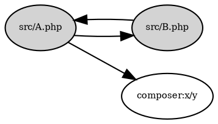

# Reports

`untangled report` renders an analysis for people. It takes the same input and
options as `analyze` (a project or a pairs document, `--cluster`, `--include`,
`--exclude`) plus:

| option | meaning |
| --- | --- |
| `--format=html` | The HTML report (default). |
| `--format=dot` | The unit graph as Graphviz DOT, see [DOT graph](#dot-graph). |
| `--style=classic` | With `--format=dot` only: the [classic style](#classic-style), snakefood's black and white look. |
| `--title=TEXT` | The report's title. Default: the project's package name (for PHP, `name` in `composer.json`), else the folder or file name. |

## HTML report

The audience is anyone who has to decide about the code, not only the people
who write it, so the report explains before it measures.

The report MUST be a single self-contained HTML file: styles, scripts and data
inline, nothing fetched from the network, so it can be emailed, attached to a
ticket or opened offline. It MUST be readable without JavaScript; scripts only
add interaction.

It MUST contain, in this order:

1. **Title and context**: the title, the generator, and what a "part" is (a
   file, or a group of files and how they were grouped).
2. **At a glance**: one sentence saying whether there are cycles, and how many
   parts they involve, followed by the project summary of
   [metrics](metrics.md#project-summary) in words ("parts of the code",
   "dependencies between them", ...).
3. **Why this matters**: a short explanation of coupling and of cycles for a
   non-engineer, including the cycle's plain-language line.
4. **Map**: the unit graph, drawn with arrows from a unit to what it depends
   on. Units in a cycle and edges inside a cycle are marked with a status
   colour and a legend label, never by colour alone. Selecting a unit shows
   its metrics with their plain-language lines and its neighbours. The map
   offers the [DOT graph](#dot-graph) for download.
   A map of more than 300 units is neither readable nor quick to lay out, so
   it draws the 300 units with the highest `fan_in + fan_out` (ties by id),
   and the edges between them, and says so above the map. Every unit can
   still be selected from the search box and the tables, and its details say
   when it is not drawn.
5. **Cycles**: each cycle with its `example` loop written out, and its full
   member list when the example does not show every member.
6. **Where to look first**: the units with the highest `fan_in` and the units
   with the highest `fan_out` (non-zero only), with their plain-language lines.
7. **Every part**: a table of every unit and its metrics.
8. **Outside the project**: the external packages and the unresolved
   references, each with how many units use it, the most used first (ties by
   id). After the first 15 of each, the rest are folded away.
9. **Groups** (clustered reports only): each cluster's members and how many
   file edges fell inside it.
10. **How to read the numbers**: every metric shown, with its plain-language line.

Wherever a metric is explained, the report MUST use the plain-language line of
[metrics](metrics.md) verbatim (or a translation of it). `null` instability is
shown as "none", never as 0.

Reports carry the generation date, so unlike documents they are not
byte-for-byte reproducible and have no conformance fixtures.

## DOT graph

`--format=dot` writes the unit graph for [Graphviz](https://graphviz.org), so
it can be rendered with `dot -Tsvg` or pasted into any DOT viewer. Only units
and the edges between them are drawn; external and unresolved nodes are left
out, as they are from metrics. The output is deterministic:

- The four header lines are written exactly as above.
- One statement per unit, in the order of the analysis `units` list, then one
  per unit-to-unit edge, in the order of the pairs document's edges. A blank
  line precedes each of the two blocks when it is not empty.
- Ids are DOT quoted strings: `\` is written `\\`, `"` is written `\"`.
- A cluster unit has `label="<id>\n<n> file(s)"` ("1 file", "2 files").
- A unit in a cycle, and an edge whose two ends are in the same cycle, get
  `color="#d03b3b", penwidth=2`, after the label if there is one.
- Two-space indentation, `\n` line endings, and a trailing newline.

### Classic style

`--style=classic` writes the graph the way snakefood's `sfood-graph` draws it:
grey ellipses for the project's units, white ellipses for what they use outside
the project, plain black edges, small serif labels, no cycle colour. Unlike the
default style it also draws the `external` and `unresolved` nodes that units
depend on (as the report's "Outside the project" section lists them); `builtin`
nodes stay out. Any other `--style` value, or `--style` without `--format=dot`,
is a usage error.

- The four header lines are written exactly as above.
- One statement per unit, in the order of the analysis `units` list (a cluster
  unit keeps its `label`, and nothing else), then one per used `external` or
  `unresolved` node with `[fillcolor=white]`, in the order of the document's
  nodes, then one per edge from a unit to a unit or to such a node, in the order
  of the document's edges. A node is "used" when at least one of those edges
  points to it. A blank line precedes each of the two blocks when it is not
  empty.
- Quoting, indentation, line endings and the trailing newline are as above.
